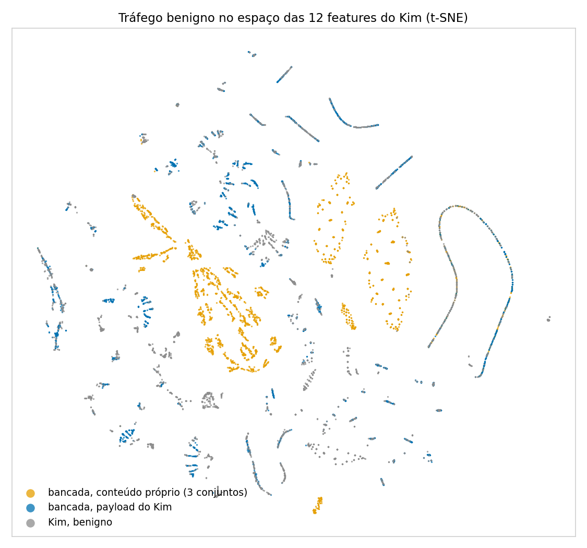

# Mudança de domínio: tráfego benigno do Kim × bancada

O tráfego benigno da bancada (`someip-testbench`) e o do dataset do Kim ocupam regiões diferentes
do espaço das features. Quando a bancada reproduz os payloads do Kim, as regiões passam a se misturar.

**Mistura por vizinhos, no espaço original** (não na projeção): fração dos 10 vizinhos mais próximos
que pertencem ao outro grupo. 0 = separados; 0,5 = indistinguíveis. 3.000 pacotes por grupo, média e
desvio de 5 sorteios.

| par | 12 features (Kim) | 16 features (+ 4 da C1) |
|---|---|---|
| Kim × bancada, conteúdo próprio, conjunto 1 | 0,050 ± 0,001 | 0,037 ± 0,001 |
| Kim × bancada, conteúdo próprio, conjunto 2 | 0,049 ± 0,002 | 0,035 ± 0,002 |
| Kim × bancada, conteúdo próprio, conjunto 3 | 0,054 ± 0,001 | 0,038 ± 0,001 |
| Kim × bancada com payload do Kim | 0,234 ± 0,006 | 0,195 ± 0,003 |
| controle: bancada, conjunto 1 × conjunto 2 | 0,443 ± 0,003 | 0,441 ± 0,002 |
| controle: Kim × Kim (duas metades) | 0,496 ± 0,002 | 0,497 ± 0,003 |

Os controles mostram que a medida distingue o que deve: duas rodadas independentes da bancada e
duas metades do Kim saem quase indistinguíveis. A bancada com conteúdo próprio quase não se mistura
com o Kim; trocar só o payload pelo do Kim multiplica a mistura por 4 a 5. O resto da diferença
(0,23 contra 0,5) vem do que o payload não cobre: tempos, tamanhos e a ordem dos pacotes.

As distâncias entre as ilhas do t-SNE não têm significado; a figura ilustra, a tabela é a evidência.
A mesma imagem se repete com 4 sorteios e inicializações ([img/tsne_dominio_sementes.png](img/tsne_dominio_sementes.png)).

Reproduzir: `scripts/tsne_dominio_amostra.py` no runner, depois
`python scripts/tsne_dominio_plot.py tsne_dominio.npz` (sklearn, matplotlib).
